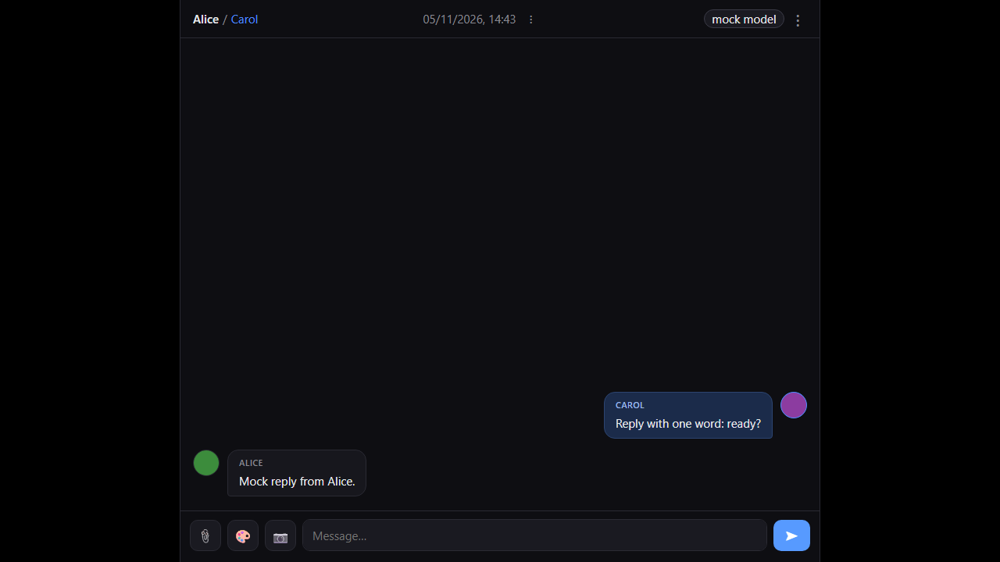

# sillytalk

A chat app for talking to **AI characters**, with **first-class image support**. A user chats with a
configured AI persona; the model can see the pictures in the chat (vision) and draw new ones when
the user asks for it — from a prompt, or from the reference pictures the user points at.

Think of it as a simpler, modern take on SillyTavern / Agnai.

Stack: **Node.js / Express 5 / TypeScript** (backend) + **Angular 22 / SCSS** (frontend).

## Features

- Chat with multiple AI characters (name, description/system prompt, a "starter" photo set folder, avatar).
- User profiles (personas): a name, a description that is passed to the model as information about
  the interlocutor, and an avatar. The persona and the character are picked separately for each
  chat (when creating the chat or in the menu on the name in the header). The user's and the
  character's avatars are shown next to their messages.
- Several OpenAI-compatible models (each with its own `baseUrl` and key), including models that can
  see images.
- Pictures are the user's: a photo attached with 📎 goes into the chat as its own **picture card**
  (a message of `kind: 'image'`) right after the caption, with what is on it written on the card.
  A model that can see images is actually shown them.
- **🎨** — a prompt box that draws a picture into a card (with the reference pictures of the chat
  picked as its inputs).
- **📷** — on your turn, one click lets the model look through the whole dialogue, decide what
  picture fits the moment, name it in a few English words and pick the references — a placeholder
  card appears in the chat immediately and turns into the picture when it is ready, so nothing is
  blocked while it is planned and drawn.
- Every picture is addressed by its path relative to the data folder and keeps its description and
  generation data in **one global images table** (`images.db` at the data root, one row per picture,
  keyed by that path) — the single source the chat cards, the planner and the browser all read.
- **Pictures library** (the ⋮ menu — "Pictures") — every picture of the data folder in one chat-
  independent browser: edit any picture's description and prompt, change its references, and rename
  it (the file moves and the cards and the stored references follow the new path).
- Image generation by several backends (all the enabled and available ones are used; the jobs of one
  generator are queued, different generators run in parallel):
  - **ComfyUI** — a generator is a ComfyUI URL plus one of the models the app ships workflows for
    (`qwen-image-2.1`, `qwen-image-2512`), the GPU device and the picture size, so one ComfyUI
    server running two models is two generators;
  - **SD API (Stable Diffusion WebUI)** — via the API (`/sdapi/v1/txt2img`, `/sdapi/v1/img2img`).
  Generation always runs in the background: the chat stays usable, a spinner with Cancel shows
  while it runs and a failed picture keeps a Regenerate button. A click on a picture enlarges it
  and makes it a generation reference.
- Per-chat settings (the ⋮ next to the chat date — "Chat settings…"): the sampling overrides of
  this chat (temperature / min-P / repetition penalty, each unset = the provider default) and a
  free-text addition to the system prompt of every reply here.
- Black theme, a centered chat column, responsive for both desktop and phone.
- The header: the participant names open the characters menu (who is in the chat and in what order
  they answer, plus edit/new), the persona name opens the persona menu, the model chip picks the
  model, the chat date opens the chat list and "new chat", the ⋮ next to it holds "Chat settings…"
  and "Delete chat", and the "⋮" in the corner opens the settings.

## Screenshots



<details>
<summary>More screenshots</summary>

- [02a-sent-waiting.png](e2e/screenshots/02a-sent-waiting.png) — a message sent, waiting for the reply
- [05-new-chat.png](e2e/screenshots/05-new-chat.png) — a new empty chat
- [08b-persona-second-message.png](e2e/screenshots/08b-persona-second-message.png) — the next message under the new persona
- [09b-group-replies.png](e2e/screenshots/09b-group-replies.png) — group replies after the mention
- [09c-user-message-edited.png](e2e/screenshots/09c-user-message-edited.png) — an edited user message
- [09d-continued-after-edit.png](e2e/screenshots/09d-continued-after-edit.png) — continuing the conversation after the edit

</details>

## Requirements

- Node.js 20+ (tested on Node 24).
- Optionally: a running OpenAI-compatible backend and/or an SD API (Stable Diffusion WebUI)
  server for image generation.

## Install

```bash
npm run install:all
```

(installs the root, `backend/` and `frontend/` dependencies)

## Run

### Production mode (a single server)

```bash
npm run build
npm run start
```

Open <http://localhost:3210> — the backend serves both the API and the built frontend.

### Development mode (hot reload)

```bash
npm run dev
```

- the backend — <http://localhost:3210>
- the frontend (the dev server, proxies `/api` to 3210) — <http://localhost:4200>

### Command line

The published `sillytalk` command runs the app when it is given no argument and the CLI when it is
given one. In this repository the same CLI is `npm run cli --` (after a build):

```bash
npx --yes sillytalk                                  # the app, same as `npm run start`
npx --yes sillytalk test-comfyui http://127.0.0.1:8188
npm run cli -- test-comfyui http://127.0.0.1:8188    # the same from this repository
```

`test-comfyui <url>` is the way to find out why a ComfyUI server draws nothing, without opening
its console: it walks the same chain the app walks and prints every step — the server and its GPUs
(`GET /system_stats`), the workflow files the app can draw with and why a file it holds is not one,
the converter node (`POST /workflow/convert`) for every template, the node classes and model files
the server actually has (`GET /object_info`) compared with what the workflows ask for, and then
**one real picture per template** (text, 1 reference, 2 references), kept in
`~/.config/sillytalk/comfyui-test/` so you can look at them. A failing step is reported with the
reason and what to do about it (a missing custom node, a checkpoint the server does not have,
a full GPU, a server bound to 127.0.0.1 only).

It reads nothing of your config and changes nothing — the URL, the size and the GPU are arguments:

| Option | What it does |
| --- | --- |
| `--model <name>` | only this workflow (repeatable) |
| `--size <WxH>` | the size of the test pictures (default `1024x1024`) |
| `--device <gpu>` | the GPU the workflow pins its loaders to (default `cuda:0`) |
| `--prompt <text>` | the prompt of the test pictures |
| `--out <dir>` | where the test pictures go (default `<data root>/comfyui-test`) |
| `--no-refs` | draw the text template only |
| `--no-draw` | run the checks and draw nothing |

Exit code: `0` clean, `1` something failed or needs a look, `2` a bad command line. Ctrl+C stops
the run and tells the server to drop the job it was given.

## Configuration

Stored in `~/.config/sillytalk/config.json` (created automatically on the first run, with
examples). It can be edited as a file or through the app's **Settings** menu.

Example:

```jsonc
{
  "listen": "0.0.0.0:3210", // the server listen address (host:port)
  "llmModels": {
    // The key — the model name inside the app (displayed and picked in the menu),
    // referenced by the Chat.modelId field.
    "openrouter/anthropic/claude-3.5-sonnet": {
      "id": "anthropic/claude-3.5-sonnet", // the ID sent to the provider (the OpenRouter model slug)
      "baseUrl": "https://openrouter.ai/api/v1",
      "apiKey": "", // the key directly, or
      "envKey": "OPENROUTER_API_KEY", // the name of an env var holding the key (takes priority)
      "contextSize": 200000,
      "supportsImages": true,
      "reasoning": false, // the reasoning level (false = off), one of reasoningLevels
      "reasoningLevels": ["low", "medium", "high", "xhigh", "max"], // optional (the default set)
    },
  },
  "imageGenerators": [
    // A generation method: "kind" says which one — "comfyui" or "sdapi".
    // Every enabled and available method works in parallel; the jobs of one
    // server are queued (one at a time). "enabled" defaults to true.
    {
      "kind": "comfyui",
      "url": "http://127.0.0.1:8188", // the ComfyUI server
      "model": "qwen-image-2.1", // one of the models the app has a workflow for
      "device": "cuda:0", // the GPU the workflow pins its model loaders to
      "width": 1328,
      "height": 1328,
      "enabled": true,
    },
    {
      "kind": "sdapi",
      "url": "http://127.0.0.1:7860",
      "steps": 30,
      "width": 768,
      "height": 768,
      "denoisingStrength": 0.75,
      "negativePrompt": "",
      "enabled": true, // generator toggle (default true)
    },
  ],
}
```

The config is flat: the provider connection is stored straight in each `llmModels` entry
(`baseUrl`, `apiKey`/`envKey`, `contextSize`) — there is no separate "providers" level. The key is
resolved by `resolveApiKey()`: `envKey` (an environment variable) takes priority over
`apiKey` (the literal key).

- `llmModels[].supportsImages: true` — the model can receive images in the chat (then the pictures
  of the cards are passed into the prompt as `image_url`; without it the cards are described to the
  model in the history text instead).
- `llmModels[].reasoning` — the reasoning level: a string — the level, sent in both common
  OpenAI-compatible spellings at once: top-level `reasoning_effort` (OpenAI, llama.cpp) and
  `reasoning.effort` (OpenRouter); `false` = off, sent as `chat_template_kwargs.enable_thinking=false`
  (the reliable cross-backend off-switch — a provider ignores a field it does not know).
  `llmModels[].reasoningLevels` — the possible levels; when absent the
  default set `low, medium, high, xhigh, max` applies. Edited in the model dialog (the "Reasoning
  levels" input + the "Reasoning" pick).
- Characters are **not stored in the config**: each one is a row of the `characters` table in the
  catalogs database `~/.config/sillytalk/catalogs.db` (`node:sqlite`), keyed by its ID — created and
  edited in the app; the ID is also the name of the character's folder
  `~/.config/sillytalk/characters/<id>/`, where its pictures live. The old `characters` field in
  the config is migrated into the table automatically at startup.
- Users — like the characters: rows of the `persons` table of the same database (the name and the
  persona description), with `~/.config/sillytalk/users/<id>/` folders holding their pictures.
  There is no "current" user in the config anymore: each chat picks its own persona
  (`Chat.userId`) — in the menu on the name in the header or when creating a chat.
- Avatars: `users/<id>/avatar.jpg` and `characters/<id>/avatar.jpg` — uploaded in **Settings**,
  shown next to the messages.
- Image generation: there can be several methods (`imageGenerators`), each named by its `kind`
  (`comfyui` or `sdapi`) and carrying an `enabled` toggle (default `true` — a disabled method is
  never used; an entry whose `kind` the app does not know is dropped). At app startup every method
  is probed: a ComfyUI server answers `GET /system_stats`, the SD API answers
  `GET /sdapi/v1/sd-models`, and a workflow file has to define the ComfyUI generator's `model`.
  **Every enabled and available method is used**: images can be generated on several generators at
  the same time, while the jobs of one server are queued (one at a time — the GPU is not hit by
  several runs concurrently; two ComfyUI generators of the same URL share that queue and take the
  jobs in turn).
- A ComfyUI generator runs the workflow of its `model` on that server, so the server needs the
  models of the workflow and the `comfyui-workflow-to-api-converter-endpoint` node (it turns the
  UI-format workflow into the API format the server executes). `device` is the GPU the workflow pins
  its model loaders to — on a multi-GPU server, one generator per GPU.
  `sillytalk test-comfyui <url>` checks exactly these prerequisites and draws one real picture per
  template — see [Command line](#command-line).
- **A ComfyUI workflow is an ordinary JSON file, so you can replace it without rebuilding the
  app.** The app ships `qwen-image-2.1.json` and `qwen-image-2512.json` (in the source tree:
  `backend/src/image_generation/comfyui/workflows/`, and the build copies them next to the compiled
  code); put your own `~/.config/sillytalk/comfyui/<model>.json` to replace one of them under the
  same name — copying the shipped file out and editing it is the usual way — or to add a model the
  app has never heard of: it appears in the model pick of a ComfyUI generator right away (the file
  name is the model name). The file holds the ComfyUI graph in the UI format (the
  format ComfyUI's own "Save" writes) under `text`, `oneImage` and `twoImages` — the workflow to
  run at 0, 1 and 2 reference images; ship fewer of the three and the model simply takes fewer
  references. Where the parameters belong, the template carries the placeholders the app fills in
  before submitting: `PARAM_PROMPT`, `PARAM_SEED`, `PARAM_DEVICE`,
  `PARAM_INT_OUTPUT_IMAGE_WIDTH` / `_HEIGHT`, `PARAM_STRING_OUTPUT_IMAGE_FILENAME` and
  `PARAM_STRING_INPUT_IMAGE_FILENAME` (`_1`, `_2` when there are two). Steps, CFG and the sampler
  are yours to set inside the file — the app changes only those placeholders. The files are read
  again for every generation, so a save is enough; a file that is not a workflow leaves its model
  out of the app, and the server log says why.

## Data storage

- Config: `~/.config/sillytalk/config.json`
- Characters and users (the cards): `~/.config/sillytalk/catalogs.db` — a SQLite database
  (`node:sqlite`) with two tables, `characters` and `persons`, each row keyed by the ID that is
  also the name of the entity's folder below
- Characters: `~/.config/sillytalk/characters/<id>/` — folder name = character ID; `photos/` — the
  "starter" photos; `avatar.jpg` — the avatar (the card itself is the row of `catalogs.db`)
- Users: `~/.config/sillytalk/users/<id>/` — `avatar.jpg` — the avatar (the card is the row of
  `catalogs.db`)
- ComfyUI workflows of your own: `~/.config/sillytalk/comfyui/<model>.json` — replaces the workflow
  the app ships for that model name, or adds a model (empty by default)
- Test pictures of `sillytalk test-comfyui`: `~/.config/sillytalk/comfyui-test/` — written by that
  command only (`--out` sends them elsewhere); nothing reads them, delete them whenever you like
- Chats: `~/.config/sillytalk/chats/chats.db` — a SQLite database (`node:sqlite`) with the chat
  fields and the messages; the pictures stay plain files in
  `~/.config/sillytalk/chats/<chatId>/files/` (the old per-chat `chat.json` files are imported
  into the database once and renamed to `chat.json.migrated`)
- What is known about a picture: `~/.config/sillytalk/images.db` — one SQLite table with one row per
  picture of the data folder, keyed by its path relative to that folder: what the picture shows, the
  prompt it was drawn from, its references and the people on it. The single source the chat cards
  read, and what the Pictures browser edits. The old `<image>.png.json` files next to a picture are
  the previous format: they are not read, not merged and not deleted — clear them yourself if you
  have any

The server has **no login** — anyone who can reach the listen address can read the chats and generate
with your models, so keep `listen` on `127.0.0.1` unless you put it behind something that
authenticates. What it exposes over HTTP is limited to what the app itself shows: the file route
serves pictures of the chat, character and persona folders and nothing else from the data folder —
the config (with the provider key), your workflow files and the chat database are not readable
through it.

## Project structure

```
backend/
  src/
    index.ts       # the express server: the API + the frontend statics
    routes.ts      # the REST API assembler (config, characters, persons, chats,
                   # image, pictures, media) over the per-domain <domain>.routes.ts
    text_generation/ # the LLM domain: the OpenAI-compatible chat/completions
                     # call (text + the pictures of the cards), the prompts, the
                     # picture plan of the user's turn —
                     # the TextGenerationService class + its DI token
    image_generation/ # generation: the driver interface, the ComfyUI / SD API
                      # backends (comfyui/ — the workflows of the models the app
                      # can run), the top-level service class
                      # (background jobs); di.ts — the minimal DI container
    images/        # what is known about a picture: the global images.db table
                   # (ImageMetaService) and the picture browser's service
                   # (browse / edit / rename) — the classes + their DI tokens
    chats/         # the chat storage in the chats.db SQLite database: the text
                   # messages and the picture cards, the pictures addressed by
                   # their data-root-relative ids, the cards filled from the
                   # images table —
                   # the ChatsService class + its DI token
    shared/         # cross-domain helpers: the image id <-> path mapping, the
                    # row shape of the images table, avatars, file streaming
    characters/    # the character storage in the characters/<id>/ folders —
                   # the CharactersService class + its DI token
    users.ts       # the user storage in the users/<id>/ folders
    config.ts      # the config load/save, the paths
    types.ts       # the types
frontend/
  src/app/
    app.ts         # the root component (the header, the chat, the input, the menus)
    settings.ts    # the settings modal (the config, the users, the characters)
    settings.scss  # the settings dialog styles
    api.ts         # the HTTP client service + the types
    app.scss       # the styles (the dark theme, responsive)
```

## Build / tests

```bash
npm run build           # the backend (tsc) + the frontend (ng build) build
cd backend && npm test  # the backend tests (jest)
cd frontend && npm test # the frontend tests
cd e2e && npx playwright test  # the browser suite (mocked model and ComfyUI)
npm run test:e2e        # the same, then drop the screenshots that did not change
npm run shots:clean     # drop the re-taken screenshots whose pixels are identical
```

A test run rewrites every screenshot it touches and most of those rewrites are noise (the encoder
and a clock that moved), so `npm run shots:clean` compares the DECODED PIXELS with the committed
ones and restores what only looks modified. It reports the numbers for every picture and writes a
picture of the difference next to each one it is not sure about.

## License

MIT — see [LICENSE](LICENSE).
